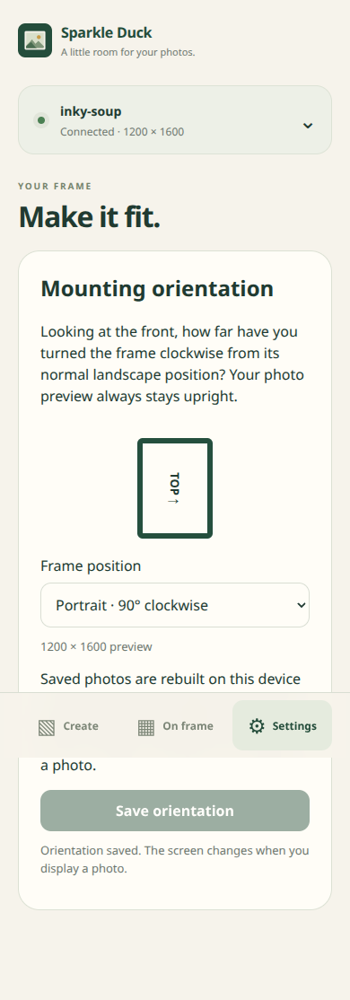
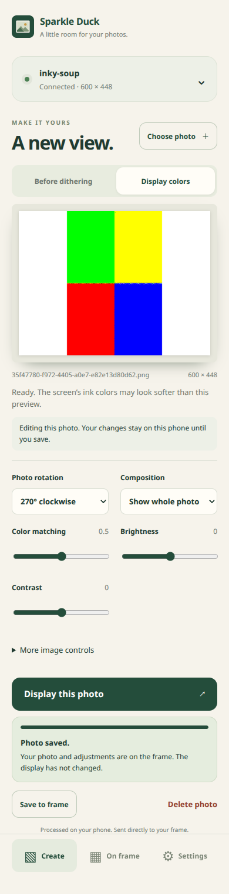
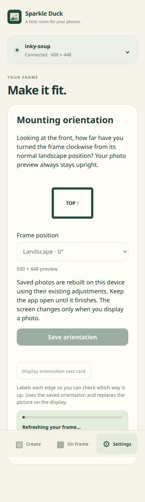
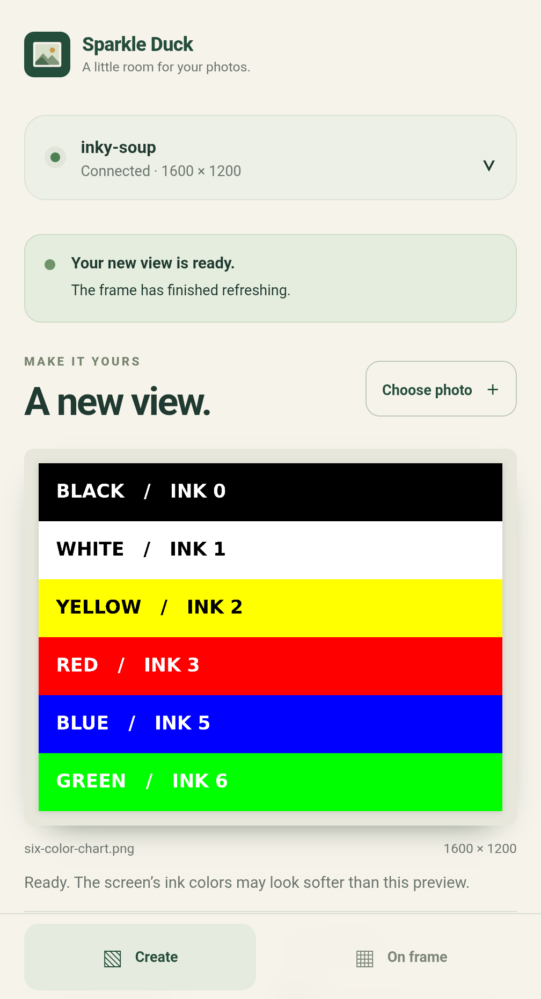

# Frame app

The `/frame/` entry is a phone-oriented PWA built with the existing Vite and vanilla
JavaScript stack. Install it from Android Chrome, connect to the frame’s local
address, choose a photo, adjust fit, brightness, contrast, color matching, resize filter, and dithering, then save or send it to the display.
It requires the app API update from the Inky Soup project.

## Data flow

- Bluetooth WiFi setup remains at `/setup/`. The app opens `/setup/?return=frame`;
  successful provisioning returns a validated local device address in the URL hash.
- The phone reads the display model/dimensions and gallery directly from the Pi.
- A Web Worker resizes, generates a thumbnail, and dithers using the display’s
  native palette. The 13.3-inch 2025 panel uses six colors at 1600 × 1200;
  the 5.7-inch panel uses seven colors at 600 × 448.
- The client saves the original and derived PNGs to the Pi, uses its image locks,
  submits one display job, and polls that job until success or failure. Lost
  connectivity never causes an automatic second flash submission.
- IndexedDB retains the current photo draft and settings on the phone. LocalStorage
  remembers the frame configuration and an active job. Storage is optional, but
  recovery cannot survive a reload when browser storage is disabled.

Photos never go to the hosted site. It serves app assets only; photo/API requests
use the local frame’s HTTP origin and need Chrome’s local-network permission.
The frame API permits the exact hosted origin and has no local-client authentication.
The current browser baseline is Android Chrome; other browser/platform combinations
are not validated for the hosted HTTPS-to-local-HTTP connection.

## Mounting orientation

Settings → Mounting orientation selects how far the frame has been turned
clockwise, viewed from the front: 0°, 90°, 180°, or 270°. Requires the matching
[Inky Soup orientation update](https://github.com/aortez/inky-soup/pull/5) and its
display script; older servers keep working but cannot change orientation here.
The preview stays upright and uses the frame's logical dimensions (1200 × 1600
for a portrait 13.3-inch frame). The server counter-rotates pixels for the panel.

Changing orientation saves it on the Pi and rebuilds saved photos sequentially
on the client with their existing adjustments. Rebuilding takes edit ownership
before reading each photo's latest settings. A photo busy elsewhere can be retried.
Progress appears in On frame; failed work is retryable and reconnecting resumes
missing assets. Keep the app open while rebuilding. Unsaved draft adjustments
remain local, and no display job is submitted automatically.

If a remembered display job delays rebuilding on reconnect, rebuilding resumes
when that job finishes, fails, expires, or is identified as belonging to an old
server lifetime. A running job or a temporary status-request failure still blocks
rebuilding; recovery never submits another display refresh.

Prepared pixels carry the revision of the configuration that produced them, so
an old tab cannot upload or flash against a new orientation. Queued display jobs
keep their original pixels and orientation. The Rust CLI can read/set the same
setting with `inky-cli orientation [0|90|180|270]`; reconnect this app after a CLI
change to update dimensions and rebuild the gallery. Offline drafts retain their
last known logical dimensions until reconnecting.



Validated on 2026-10-25 with the original Pi Zero W and 13.3-inch 2025 panel:
desktop Chromium at a phone viewport used the real USB API to save orientation,
rebuild at all four angles, and complete a 90° portrait refresh. The user confirmed
the physical chart's direction. CLI changes were picked up on reconnect; settings
survived server restart, and a prepared portrait CLI upload passed. This used an
isolated temporary library, which was stopped afterward; the normal service and
its 15 photos were preserved. This orientation build has not yet been tested on
Android hardware. [Validation results](../docs/validation/frame-orientation-pi-zero-w.json).

## Photo rotation and orientation test card

The Create editor has a **Photo rotation** control for new photos and photos
opened from On frame. Angles are absolute clockwise quarter-turns relative to the
original (after browser image-orientation decoding). Rotation happens before
contain/cover fitting, filtering, adjustments and dithering, entirely on the
client. Save to frame stores the angle and rebuilds previews without flashing;
Display this photo saves and then queues a refresh. Offline drafts keep the angle.
Mounting changes and automatic gallery recovery retain each photo's rotation.

Settings → **Display orientation test card** draws a black/white edge-labeled card
at the saved mounting dimensions and displays it as a temporary job. Save an
orientation change first. Progress and retry status stay by that button. The card
replaces the displayed picture, leaves the current draft intact, and adds nothing
to the gallery. Normal job tracking/restart handling and PWA update blocking apply.

These features require the paired server update for inky-soup issue #15. Config
capabilities disable them on older servers while ordinary unrotated saves keep
working. Photo revisions protect against stale edits, including reverting to an
earlier angle. Pending rotation requests and accepted revisions are retained in
the draft after interrupted saves. Retrying after a lost response, even after
reopening the app, recovers the accepted rotation without discarding adjustments
or uploading another original. Background recovery leaves that pending photo for
the editor to retry. A subsequent rotation by another editor still requires
reopening the photo. Copying a draft to another frame or saving it after deletion
starts the new photo at revision zero.

The Rust CLI can set a photo's angle or upload one with an angle; connect this app
to rebuild its missing images before displaying it.




Validation: both display sizes/all four rotations have pixel/palette tests. The
app and CLI were exercised against the updated local Rust server with disposable
images and a validating test display command. Physical Pi/Android validation of
this change has not been performed.

## Offline and updates

`tools/frame-pwa.js` generates a content-versioned service worker from the built
entry and its dependencies. It caches only the frame app shell, icons, and worker
libraries. It never intercepts cross-origin photo or API traffic. After one online
load, a remembered configuration and saved draft can be opened and edited offline.
Gallery loading and sending still require the frame. Bluetooth setup is online.

New service workers wait until the existing app windows close, so a worker update
does not take over an in-progress editing session. Reopen the app after a website
update to use the new version.

The image libraries in `public/frame/vendor/` are pinned copies of Inky Soup’s
existing worker code. `source.json` records the source commit, paths, and SHA-256
hashes. To update them, copy both files from a tested Inky Soup commit, update the
source metadata, and rerun unit, browser, and physical display validation. Preserve
the included license. The unit suite checks the recorded hashes.

## Development and validation

```bash
npm ci
npm run dev
npm run test:unit
npm test
npm run test:pwa
```

`test:pwa` builds the production site and tests service-worker installability,
offline reload, draft recovery, and exclusion of device requests from app caches.
Development Vite deliberately does not register the service worker. For a real Pi,
add the exact local preview origin to its `INKY_SOUP_CLIENT_ORIGINS` environment
variable and restart the server. Remove development origins after testing.

On 2026-10-24 (Pacific), a Pixel 9 Pro XL running Android 17 / Chrome 156 processed
a 1600 × 1200 six-color chart, uploaded it over WiFi to the original Pi Zero W,
and observed a completed physical display job. The Rust CLI independently watched
that same job. No API responses were mocked. Unpublished static assets were
fulfilled from the local production preview through CDP at `https://allan.pizza`;
this was not a test of the public deployment or an installed production WebAPK.
The recorded viewport was 448 CSS pixels wide with no horizontal overflow and no
page errors. See [results](../docs/validation/frame-pixel9.json) and the screenshot.



Follow-up review resolved the preview launch blocker: the old preview worker was
stuck in the browser’s `starting` state. Clearing only preview worker/cache state
and restarting Chrome restored loading. A fresh installed WebAPK then passed
standalone launch, real Bluetooth setup and handoff, direct WiFi upload, successful
refresh, and offline reopening of the saved 1600 × 1200 draft. The offline test
actually disabled WiFi while mobile data was already off, and removed the localhost
ADB reverse. Editing remained enabled; sending was disabled. Networking was restored.
See [installed-app results](../docs/validation/frame-installed-pixel9.json).

The review also changed navigation to use the active worker’s cached HTML. This
keeps HTML and worker code on one release until a new worker takes over, and avoids
waiting for a network response when launching. Offline startup restores the frame
configuration and permits editing while disconnected.

When a complete new app version has downloaded, an **Update available** banner
offers **Reload**. The app checks when launched, when brought back to the
foreground or reconnected, and every five minutes while visible. It saves the
latest draft before activating the update and reloading once. An already
downloaded update also works offline. Failed downloads or draft saves leave the
current app open, with a retryable message for a failed save.

Reload waits while connecting, processing a preview, uploading/rebuilding photos,
or tracking a display job. Unfinished batch uploads must be retried first. If
another frame app tab or window is open on this device, the banner asks you to
close that window before reloading, so its work is not interrupted. Updates never
submit a display refresh. Older installed versions without this banner need one
manual close/reopen after downloading this release; future versions use the
button. There is no need to clear browser storage or reinstall the app.

The built-PWA suite serves successive releases over real HTTP to exercise worker
installation, activation, offline reload, draft preservation, busy states, other
windows, and failed downloads/storage. It uses disposable browser data and mock
frame APIs; it does not flash hardware.

The old `/wifi/` QR address still reaches setup. Successful setup now opens the
frame app by default, with a separate link to the original device interface.
Publishing requires the tested Vite artifact; the site CI deploys `dist/` to Pages
from `master`, including the existing Go/WASM demo’s assets. Direct branch publishing
would omit the generated service worker and use unbundled app source.

## Repeatable Android check

Install the app, choose a photo, wait for its preview, then run:

```bash
node tools/android-frame-check.mjs --origin https://allan.pizza --offline --screenshot /tmp/frame-offline.png
```

Pass `--serial` when multiple Android devices are connected. Pass the installed
`org.chromium.webapk.*` ID with `--package` to force-stop/relaunch the app and repeat
the launch offline. The tool checks standalone mode, viewport width, draft pixels,
and enabled editing/disabled sending offline. Offline mode temporarily disables
WiFi and mobile data and removes a matching localhost ADB reverse, restoring prior
settings afterward. It does not install an app or submit a display refresh.

Device-side diagnostics live in the Inky Soup Rust CLI:

```bash
./inky-cli browser-check --origin https://allan.pizza --json
./inky-cli wifi-setup start
./inky-cli wifi-setup status --json
```

The first command validates the device’s CORS read/preflight responses. Setup
controls use key-authenticated SSH and never accept WiFi credentials. After initial
publication, verify the real HTTPS installation as well as the local preview.

## Photo controls and library management

The editor preserves all saved settings when reopening a photo. The preview toggle
switches between the adjusted photo before dithering and the exact display-color
output. Brightness and contrast are applied after resizing; the stored cache stays
unadjusted, matching the device interface’s pipeline. Filter and dithering choices
are under **More image controls**. Draft recovery includes every setting.

**Save to frame** stores the original and derived PNGs without scheduling a refresh.
**Display this photo** saves the same data and submits one refresh. Status and an
indeterminate progress bar sit directly below that button; the bar completes only
when the device reports completion. Refresh details expose the job, filename,
state, and elapsed time. There is no “flash twice” control.

Select multiple photos, drop multiple files onto the preview, or use **Add photos**
in the gallery to save a batch without changing the display. Photos are processed
and saved sequentially; individual failures can be retried. A confirmed original
upload is reused on retry. Batch queues stay in memory, while the editor draft is
persisted. GIF input uses its decoded still frame.

Opening a saved photo acquires an editing lock and renews it while the page is
active. A denied or lost lock exposes read-only status and an explicit retry. The
server checks edit ownership for saved settings, display submissions, and deletion. Locks expire if the app is closed/suspended.
Deletion asks for confirmation and uses `/api/delete-image`, which requires the
photo-management server update. It refuses photos queued or refreshing and removes
the original, derived files, and metadata. The current physical display does not
change; the phone retains its draft. The corresponding device diagnostic is
`inky-cli delete FILENAME`.


Validated on 2026-10-25 (Pacific) with the original Pi Zero W, 13.3-inch 2025
panel, and Pixel 9 Pro XL (Android 17 / Chrome 156). The unpublished production
build was served through localhost ADB reverse; device API and photo traffic went
directly over WiFi to a temporary Pi server using disposable images. Save-only,
batch uploads, deletion, metadata recovery, and one completed physical display
job passed, with independent CLI checks. The installed preview also reopened a
fresh document with WiFi/mobile data off and the ADB site forward removed: all
six adjustments and the draft survived, editing stayed enabled, and sending was
disabled. Network settings were restored. This is preview validation, not a
published-site test. Evidence: [Pixel results](../docs/validation/frame-parity-pixel9.json).

Reconnect requests run independently of editing. This matters on Android, where
`navigator.onLine` can remain true even with WiFi and mobile data disabled. A slow
or failed reconnect must never disable local adjustments.

Gallery selection is disabled during a frame switch, and each gallery action is
bound to the frame that supplied it. Editing identities are reserved per document
with Web Locks: a reload can reuse its session, while duplicated/opener windows
receive separate identities. If browser locking is unavailable, each new document
uses a fresh identity; the old device lock may need up to 30 seconds to expire.

### Try an unpublished PR on Android

Build this checkout and serve it locally, then forward the preview port over USB:

```bash
npm run build
npm run preview -- --host 127.0.0.1 --port 4175 --strictPort
# In another terminal, with one authorized Android device connected:
adb reverse tcp:4175 tcp:4175
adb shell am start -a android.intent.action.VIEW -d http://localhost:4175/frame/ -p com.android.chrome
```

Use Inky Soup's `inky-cli preview start --origin http://localhost:4175` to allow
this origin; pass `--server-binary /tmp/inky-preview-server` when testing a copied
device PR binary too. Check with `inky-cli browser-check --origin http://localhost:4175`.
Connect the phone to the Pi's WiFi address, and allow Chrome's local-network
permission. Keep the USB cable connected and the local preview process running.
The localhost preview has its own draft/storage, separate from the public app.
It uses the real frame library, so saves and deletions affect real photos.

After testing, run `inky-cli preview stop`, `adb reverse --remove tcp:4175`, and
stop the preview process. Close preview windows before testing another build so
its service worker can activate the update. Neither PR has to be merged to test.
